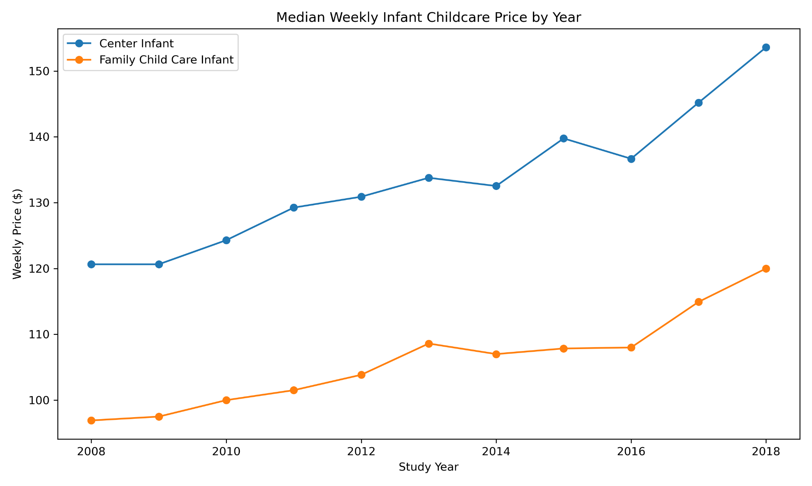
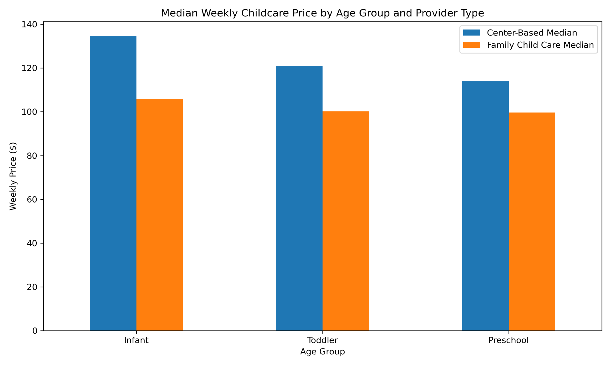
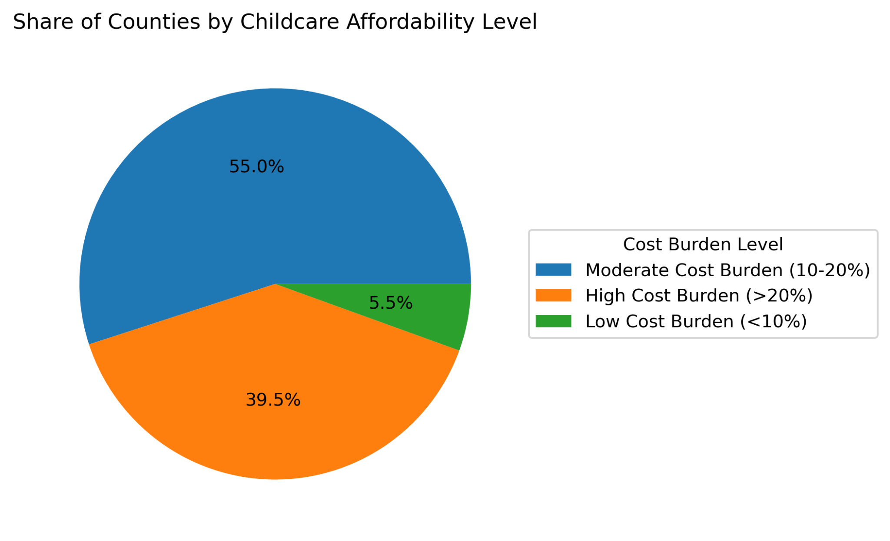

# Childcare Cost and Affordability Analysis

## Overview
This project examines U.S. childcare prices using the National Database of Childcare Prices, comparing infant, toddler, and preschool care across center-based and family childcare providers. It explores geographic differences, changes over time, and the share of median household income represented by childcare costs.

## Questions
- How do median weekly childcare prices vary by age group and provider type?
- How have infant childcare prices changed across study years?
- How does childcare cost burden differ across counties?
- What relationships exist among childcare prices, household income, and other socioeconomic measures?

## Dataset
- **Input:** `data/raw/nationaldatabaseofchildcareprices.xlsx`
- **Source:** National Database of Childcare Prices, as provided with the original project.
- **Key fields:** `StudyYear`, `State_Name`, `County_FIPS_Code`, `MCInfant`, `MCToddler`, `MCPreschool`, `MFCCInfant`, `MFCCToddler`, `MFCCPreschool`, `MHI`, and poverty/employment indicators.

## Methods
The notebook loads the Excel workbook, reviews missing values, summarizes childcare price variables, compares median prices across years and provider types, ranks states, calculates an annualized infant-care-price-to-household-income ratio, and explores correlations. Charts are saved to `outputs/`.

## Findings
The original project describes higher median infant care prices than prices for older age groups, generally higher center-based prices than family care prices, increases in infant prices across 2008–2018, and substantial differences among counties. These are descriptive patterns, not causal conclusions.

## Selected Visualizations

The `outputs/` folder also contains the original household-income comparison, population treemaps, income ranking, and poverty waffle visualization. Some supplemental images were provided separately and are not regenerated by this notebook.

## Project Structure
- `notebooks/Childcare_Cost_Analysis.ipynb` — interactive analysis
- `data/raw/` — source workbook
- `data/processed/` — reserved for derived datasets
- `outputs/` — retained original and supplemental charts
- `CLEANUP_LOG.md` — project-specific change record

## Open the notebook in Google Colab
[**Open Childcare Cost Analysis notebook in Colab**](https://colab.research.google.com/github/josephine-ms/josephine-ms.github.io/blob/main/Projects/Childcare_Cost_Analysis/notebooks/Childcare_Cost_Analysis.ipynb)

Select **Runtime → Run all**. The notebook loads the Excel dataset automatically from GitHub if it is not available locally (internet access required). Install any missing Python package in Colab if prompted; in particular, `squarify` may need `%pip install squarify`. Full fresh-Colab execution remains unverified.

## Run locally
Install the dependencies using `python -m pip install -r requirements.txt`, then open `notebooks/Childcare_Cost_Analysis.ipynb` in Jupyter and run the cells in order.

## Limitations
The data cover historical study years and do not represent current childcare prices. Missing data, county-level differences, and differing source definitions can affect comparisons. The affordability ratio is a simplified measure and does not capture taxes, household composition, subsidies, or actual individual spending. Population values aggregated across study years should not be presented as single-year population estimates; supplemental population charts should be interpreted cautiously.
